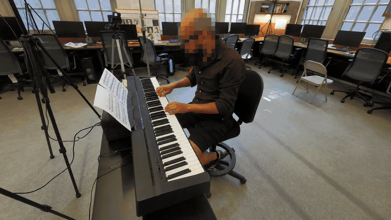
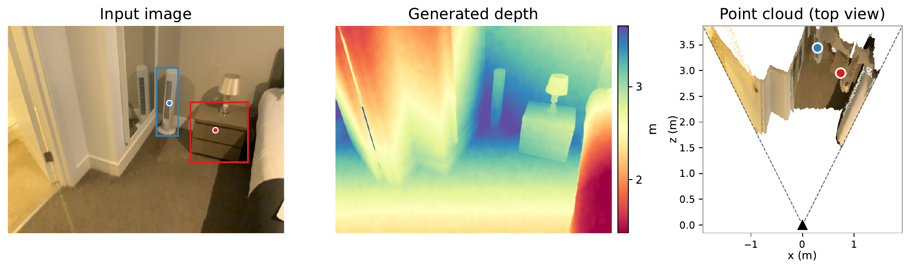

<h1 align="center">GeoUG: Learning and Reasoning with Geometry — How Generation Helps Spatial Understanding</h1>

<p align="center">
  <a href="https://yangr116.github.io/geoug-project-page/"></a>
  <a href="https://arxiv.org/pdf/2610.36022"></a>
  <a href="#models"></a>
  <a href="https://huggingface.co/datasets/rayruiyang/3DCueBench"></a>
</p>

<p align="center">
  <b>Generate geometry. Measure in 3D. Rethink the answer.</b><br>
  A unified model for geometric generation and adaptive spatial reasoning.
</p>

<p align="center">
  <a href="https://yangr116.github.io/geoug-project-page/assets/video/geoug-direct-fusion-hd.mp4">
    
  </a>
</p>
<p align="center">
  <a href="#highlights">Highlights</a> ·
  <a href="#see-geoug-in-action">Demos</a> ·
  <a href="#models">Models</a> ·
  <a href="#datasets">Datasets</a> ·
  <a href="#main-results">Results</a> ·
  <a href="#installation">Installation</a> ·
  <a href="#inference">Inference</a> ·
  <a href="#evaluation">Evaluation</a> ·
  <a href="#training">Training</a>
</p>

## Highlights

- **Learn with geometry.** Geometric co-training uses metric depth and view
  generation to improve spatial understanding.
- **Reason with geometry.** The model drafts an answer, decides whether depth
  is useful, and uses generated geometry and measurement tools to confirm or
  revise its answer. The paper's RL policy skips depth generation on
  27.6–49.7% of questions across three reasoning benchmarks.
- **Multi-scale Metric Depth Codec (MMDC).** Encode metric depth using pivots of 2 m, 8 m,
  and 32 m into a three-channel image, then encode it with an RGB VAE.
- **3DCueBench.** 800 balanced depth and 3D-distance questions, with controlled
  shortcut agreement and four difficulty intervals.

## See GeoUG in action

### Generate depth, measure in 3D, and revise the answer

GeoUG can generate metric depth and use geometry tools to check its initial
answer. The example below shows spatial reasoning on 3DCueBench.



Explore [answer corrections, direct answers, and failure cases](https://yangr116.github.io/geoug-project-page/#reasoning-cases).

### Image → metric depth

Generate depth in meters with MMDC.

<p align="center">
  <a href="https://yangr116.github.io/geoug-project-page/assets/video/gen-depth.mp4"></a>
</p>

[▶ Watch demo](https://yangr116.github.io/geoug-project-page/assets/video/gen-depth.mp4)

<details>
<summary><b>More generation demos: novel views and first-person views</b></summary>

### Explore another viewpoint

Geometric generation across views.

<p align="center">
  <a href="https://yangr116.github.io/geoug-project-page/assets/video/gen-multiview.mp4"></a>
</p>

[▶ Watch demo](https://yangr116.github.io/geoug-project-page/assets/video/gen-multiview.mp4)

### From third-person to first-person

Third-person → first-person generation.

<p align="center">
  <a href="https://yangr116.github.io/geoug-project-page/assets/video/gen-exo-ego.mp4"></a>
</p>

[▶ Watch demo](https://yangr116.github.io/geoug-project-page/assets/video/gen-exo-ego.mp4)

</details>

These research demos use GeoUG task configurations; they do not imply that all
capabilities are available in each released inference checkpoint. Video transitions
are presentation effects, not denoising trajectories.

## Models

GeoUG provides an adaptive spatial reasoning model, a metric-depth model,
and a cold-start checkpoint for RL training.

| Model | Download | Notes / capabilities | Documentation |
|---|---|---|---|
| **GeoUG-Spatial** | [Hugging Face][model-spatial-rl] | Adaptive spatial reasoning with depth generation and geometry tools; decides when geometric evidence is needed to answer a question. | [Inference guide](inference/README.md) |
| **GeoUG-Depth** | [Hugging Face][model-metric-depth] | Generates metric depth in meters from a single image for geometric measurement and 3D reconstruction. | [Inference guide](inference/README.md) |
| **GeoUG-ColdStart** | [Hugging Face][model-sft-init] | Cold-start checkpoint for initializing spatial-policy RL training. | [Training guide](docs/TRAINING.md) |

**Local use.** Place the two inference packages in
`ckpt/geoug-spatial-rl-lambda0.1/` and `ckpt/geoug-metric-depth/`, respectively,
or pass `--model-path /path/to/model`. Each package contains model configs,
tokenizer files, `transform_config.yaml`, `ae.safetensors`, `ema.safetensors`,
and SHA256 checksums. Download the complete package from the model links above.

## Datasets

### Evaluation datasets

Textual variants identify objects with coordinates in the question; visual
variants mark the objects or points on the image. Keep the variant and
ordinary/circular scoring protocol fixed when comparing models.

| Dataset | Format / task | Download | Notes / protocol |
|---|---|---|---|
| **3DCueBench** | Image-embedded parquet; depth ordering and 3D-distance ordering | [Hugging Face][data-3dcuebench] | One self-contained parquet: 800 questions on 757 images; 400 depth + 400 distance questions, four difficulty bins, balanced A/B answers. [Data card and validation](benchmarks/3dcuebench/README.md). |
| **DA-2K Textual** | Single image-embedded parquet; relative depth with textual point coordinates | [Reproduce locally][data-da2k-textual] | 2,068 relative-depth questions with textual point coordinates; supports model-specific coordinate formats and circular evaluation. [Evaluation guide](evaluation/vlmevalkit/README.md). |
| **DA-2K Visual** | TSV; relative depth with colored point markers | [Reproduce locally][data-da2k-visual] | Relative-depth questions with colored point markers; circular evaluation swaps the marker colors between the two points. [Evaluation guide](evaluation/vlmevalkit/README.md). |
| **CV-Bench-3D Textual** | TSV; depth and 3D-distance questions with textual boxes | [Hugging Face][data-cvbench-textual] | 1,200 questions: 600 depth + 600 distance, with textual bounding boxes. Supports circular evaluation. [Evaluation guide](evaluation/vlmevalkit/README.md). |
| **CV-Bench-3D Visual** | Images with visual annotations; depth and 3D-distance questions | [Via VLMEvalKit](evaluation/vlmevalkit/README.md#bagel-base-model-on-cv-bench-3d) | The evaluator downloads the upstream visual split automatically. |
| **Metric-depth evaluation suite** | NYU-v2, KITTI, ETH3D, and other configured benchmarks | [Dataset setup](evaluation/depth/README.md) | Obtain the source datasets separately and configure their local paths. [Config template](configs/eval/depth_datasets.example.json). |

## Main results

**Spatial reasoning — circular accuracy (%) ↑.** Both answer-option orders
must be correct. CV-Bench-3D and DA-2K use their Textual variants; 3DCueBench
uses textual object coordinates.

| Model | CV-Bench-3D Textual | 3DCueBench | DA-2K Textual | Average |
|---|---:|---:|---:|---:|
| GeoUG (RL policy, λ=0.1) | **97.9** | **90.8** | **94.2** | **94.3** |

**Depth estimation — affine-aligned evaluation.** GeoUG-Depth results use
scale-and-shift alignment to ground truth. AbsRel is multiplied by 100
(e.g., 3.32 means 0.0332); δ₁ is the percentage of pixels within a factor of
1.25 of ground-truth depth. These scores measure depth shape after alignment,
not absolute metric-scale accuracy.

| Dataset | AbsRel ×100 ↓ | δ₁ (%) ↑ |
|---|---:|---:|
| NYU-v2 | 3.32 | 98.46 |
| KITTI | 4.84 | 97.27 |
| ETH3D | 3.75 | 97.85 |

Results above are reported in the paper. See [evaluation scope](#evaluation-scope)
for the current reproduction status.

See the [Project Page](https://yangr116.github.io/geoug-project-page/) for the
full tables, visualizations, and reasoning traces.

## Installation

Use **Linux, a CUDA GPU, and Python 3.10 or 3.11**. FlashAttention requires a
compatible CUDA build environment. SFT, RL, and VLMEvalKit use separate
dependency sets.

```bash
git clone https://github.com/hku-sail/GeoUG.git
cd GeoUG
```

```bash
# SFT, standalone inference, and depth evaluation
python -m venv .venv-sft
source .venv-sft/bin/activate
pip install -r requirements.txt
pip install flash_attn==2.5.8 --no-build-isolation
```

Run all commands from the repository root. To use GeoUG from other directories,
also run `pip install -e . --no-deps` in the SFT environment. See the
[setup guide](docs/STANDALONE.md) for environment details and installation checks.

For the separate RL environment, see [training setup](docs/TRAINING.md#environment-setup).

```bash
# VLMEvalKit
python -m venv .venv-eval
source .venv-eval/bin/activate
pip install 'setuptools==69.5.1'
pip install -r requirements-eval.txt
```

## Inference

The commands below use the default local model directories listed in the
[Models](#models) section. Pass `--model-path` to use a different location.

After downloading the model packages, run these examples with the bundled
[example image](docs/assets/example-scene.png), also used on the project page.
Point coordinates are normalized to 0–1000 along each image axis. In this
image, point A (400, 650) is on the foreground keyboard and point B (800, 350)
is on the folding chair to the right. These commands demonstrate inference;
they are not benchmark evaluation cases.

Generate metric depth:

```bash
python -m inference.depth \
  --image docs/assets/example-scene.png \
  --output-dir outputs/depth
```

Run adaptive spatial reasoning:

```bash
python -m inference.spatial \
  --image docs/assets/example-scene.png \
  --question 'Which point is closer to the camera, <point>400 650</point> A or <point>800 350</point> B?'
```

Use `--mode force_depth` or `--mode force_answer` to override the branch at the
model's `<DECIDE>` marker. If the model answers before that marker, the override
is not applied. See the [inference guide](inference/README.md) for output fields,
camera intrinsics, and output formats.

## Evaluation

### Evaluation scope

Standalone adaptive spatial inference is available through `inference.spatial`.
The VLMEvalKit commands below evaluate registered open-source VLMs and BAGEL
base; they are not an end-to-end reproduction command for GeoUG's adaptive RL
policy. Full reproduction of the paper's adaptive-policy results with the
current evaluation code remains pending.

### Open-source VLMs and BAGEL base

VLMEvalKit launchers are included under `evaluation/vlmevalkit/`.

```bash
# BAGEL base on visual CV-Bench-3D, ordinary and circular
NPROC_PER_NODE=8 \
bash evaluation/vlmevalkit/run_bagel_base_cv3d.sh

# Any registered open-source model on the three textual paper benchmarks
MODEL=Qwen2.5-VL-7B-Instruct \
THREEDCUEBENCH_PATH=/path/to/3dcuebench.parquet \
CVBENCH_3D_TEXTUAL_PATH=/path/to/cvbench3d-textual.tsv \
DA2K_TEXTUAL_PARQUET=/path/to/da2k-textual.parquet \
NPROC_PER_NODE=8 \
bash evaluation/vlmevalkit/run_spatial_suite.sh
```

Set `COORD_STYLE` for non-Qwen2.5 models. The launcher reports circular
accuracy for 3DCueBench, CV-Bench-3D Textual, and DA-2K Textual. See
[the evaluation guide](evaluation/vlmevalkit/README.md). The paper suite uses deterministic exact
matching by default; set `JUDGE` only when intentionally testing another
answer extractor.

### Metric depth

Start from `configs/eval/depth_datasets.example.json`, then run:

```bash
bash scripts/eval_depth.sh \
  --dataset-config /path/to/depth_datasets.json \
  --depth-type metric
```

The evaluator reports metric, scale-invariant, affine-invariant, and
disparity-aligned depth metrics. See the [depth evaluation guide](evaluation/depth/README.md).

### 3DCueBench

Download the [released parquet][data-3dcuebench], then validate it:

```bash
python benchmarks/3dcuebench/validate.py \
  /path/to/3dcuebench-v1.0.0.parquet
```

Score predictions containing `question_id` and `prediction`:

```bash
python benchmarks/3dcuebench/evaluate.py \
  --dataset /path/to/3dcuebench-v1.0.0.parquet \
  --predictions /path/to/predictions.jsonl \
  --output outputs/3dcuebench/metrics.json
```

The published release contains 800 questions on 757 images in one image-embedded
parquet. No separate image directory or metadata download is required. See the
[download and evaluation guide](benchmarks/3dcuebench/README.md).

## Training

See the [training data card](docs/TRAINING.md#training-data-card) for dataset
downloads and availability, and the [training guide](docs/TRAINING.md) for
environment setup, and SFT / RL training instructions.

## Repository layout

```text
configs/                 SFT, RL, inference, and evaluation configs
data/                    Dataset readers, packing, transforms, and MMDC
modeling/                BAGEL-based unified model
train/sft/               FSDP SFT implementation
train/rl/                GeoUG RL implementation and bundled training engine
inference/               Metric-depth and adaptive spatial inference
evaluation/depth/        Metric-depth evaluation
evaluation/vlmevalkit/   Open-model and circular spatial evaluation
benchmarks/3dcuebench/   3DCueBench export, validation, and scoring
third_party/VLMEvalKit/  Fixed evaluation snapshot with GeoUG adapters
ckpt/                    Local model packages (create after download; ignored by Git)
scripts/                 Public launchers
```

<!-- Published repositories and local reproduction guides. -->
[model-spatial-rl]: https://huggingface.co/rayruiyang/GeoUG-Spatial
[model-metric-depth]: https://huggingface.co/rayruiyang/GeoUG-Depth
[model-sft-init]: https://huggingface.co/rayruiyang/GeoUG-ColdStart
[data-3dcuebench]: https://huggingface.co/datasets/rayruiyang/3DCueBench
[data-da2k-textual]: evaluation/vlmevalkit/README.md#reproduce-da-2k-textual-and-visual
[data-da2k-visual]: evaluation/vlmevalkit/README.md#reproduce-da-2k-textual-and-visual
[data-cvbench-textual]: https://huggingface.co/datasets/rayruiyang/CVBench3DTexutal
